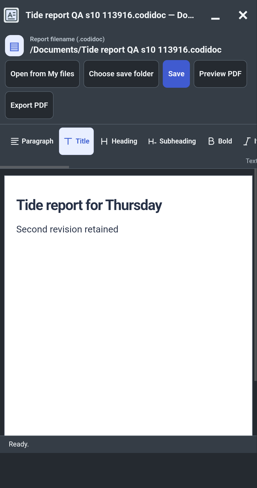

# Document Editor on the Galaxy S10+

Runtime source `40b3c11` in viewer `0a387a0bf300` bundles Tiptap and the retained PDF exporter. The [app README](../../README.md) describes the file format and build prerequisites.

1. Sign in and open **Apps → Office → Document Editor (Tiptap)**. Tap **Title** and type **Tide report for Thursday**.
2. Cancel **Choose save folder** and check the title remains. Try a `.pdf` filename, then retry with **Documents/Tide report** and tap **Save**. The saved report becomes `/Documents/Tide report.codidoc`.
3. Add a paragraph and save again. Tap **Export PDF** for a separate PDF file and **Preview PDF** to see the revised text in PDF Viewer.
4. In a fresh signed-in session, open the report from **My files**. Confirm the title and new paragraph are editable and the PDF bytes match the original export.

Chrome 158 on the physical S10+ ran the portrait workflow at 411 CSS pixels and opened the Android keyboard. Chromium repeated it at 820 and 1300 CSS pixels. The toolbar and file status follow the dark desktop palette while the report page stays white. On desktop, an explicit legacy `.doc` copy also saved and opened through the My files picker. A malformed `.codidoc` left its bytes intact and opened a separate recovery report.

The phone pass covers creating and formatting a report, recovering from a canceled picker or invalid name, saving and reopening, and PDF output. Image paste, tables, long reports, and version conflicts still need a physical-device pass. The formatting ribbon scrolls sideways on phones.

On box-webhost, `sudo python3 -I -B /var/backups/webos-document-editor-phone-report-files-0a387a0bf300/deploy-viewer.py rollback` restores viewer `0c76681810b6`.

